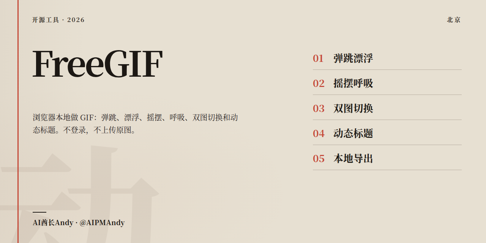

<div align="center">

# FreeGIF ✳️

### 让每一张图动起来。

**免费 · 开源 · 手机即用 · 本地处理 · 无强制水印 · MIT**

浏览器本地制作 GIF：弹跳、漂浮、摇摆、呼吸、双图切换、打字标题。不登录，不上传原图。

[**立即在线制作 GIF**](https://aipmandy.github.io/FreeGIF/) · [安装 Codex Skill](skills/freegif/SKILL.md) · [路线图](docs/ROADMAP.md)

AI酋长Andy · 流量 AI 联合创始人、星觉 AI 创始人 · 星觉科技 · 北京 · 微信 AIPMAndy

</div>



## 快速开始

**在线：** 打开 [https://aipmandy.github.io/FreeGIF/](https://aipmandy.github.io/FreeGIF/)。2026-11-15 该地址返回 HTTP 200，因为用户站点 [AIPMAndy.github.io](https://github.com/AIPMAndy/AIPMAndy.github.io) 托管了 FreeGIF 目录。本仓库的 GitHub Pages 是关闭的（`has_pages` 为 false）。上面的链接已经可以打开，不必先启用本仓库的 Pages。

**本地网页：**

```bash
python3 -m http.server 8000
# 打开 http://localhost:8000
node tests/test-site.mjs
```

也可以直接用浏览器打开 `index.html`。页面自带 CSS、Canvas 渲染器和 GIF89a 编码器，没有 CDN 依赖。

**命令行：** 使用仓库里已有的 `scripts/freegif.py`。需要 Python 3.10+ 和 Pillow；网页版不需要 Python。

```bash
python -m pip install -r requirements.txt
python scripts/freegif.py --input photo.png --mode bounce --text "今天也要加油！" --output output.gif
python scripts/freegif.py --input before.png --input-b after.png --mode flip --output compare.gif
```

Skill 说明见 [skills/freegif/SKILL.md](skills/freegif/SKILL.md)。生成后请检查 GIF 是否正常播放，以及尺寸和帧数是否符合目标平台规格。

## 常见问题

- **不是 AI 视频。** 这不是 AI 生图模型，无法自动生成复杂的角色骨骼运动或视频大片，也不承诺生成物直接通过微信表情开放平台审核。
- **调色板有限。** GIF 调色板色深有限，照片可能有轻微色带。
- **手机内存。** 低内存手机请降低输出尺寸和帧数。
- **本仓库 Pages 关着，用户站点链接是活的。** 本仓库 `has_pages` 为 false。https://aipmandy.github.io/FreeGIF/ 在 2026-11-15 返回 HTTP 200，是因为 AIPMAndy.github.io 托管了 FreeGIF 目录，不是因为本仓库打开了 GitHub Pages。

## 这是做什么的？

在浏览器里选择一张本地图片，做成弹跳、漂浮、摇摆或呼吸缩放，也可以做两张图切换或打字标题，再加文字后导出 GIF。可选署名。无需登录、会员、后端服务或 AI API。

**全部 GIF 帧和编码都在浏览器本地完成，原图不会提交到服务器。** 在线页面来自 AIPMAndy.github.io 上的 FreeGIF 目录，不是本仓库的 GitHub Pages。

### 已实现（V0.1）

| 功能 | 说明 |
| --- | --- |
| 手机与桌面 | 适配移动端的静态网页 |
| 六种模式 | 漂浮、弹跳、摇摆、呼吸、双图切换、打字标题 |
| 自定义 | 选择本地图片、文字、背景、可选署名 |
| 三种画幅 | 1:1、9:16、16:9；可设置尺寸、时长和帧率 |
| 真正的 GIF 文件 | 多帧 GIF89a 编码、循环播放、下载 |
| Python CLI + Codex Skill | 可批量自动化调用，本地生成 |
| 开源 | MIT，无强制水印、无账户或广告 SDK |

### 隐私与使用许可

图片、文本和 GIF 在浏览器本地处理；无用户上传接口、无登录、无强制水印。使用者应确认素材有合法使用权。代码 MIT 许可，详见 [LICENSE](LICENSE)。

### 灵感来源与差异化

受 [WoYun520/gif-factory](https://github.com/WoYun520/gif-factory) 启发。原项目主要面向 Agent/Codex 的高阶制作工作流；FreeGIF 提供**独立原创的零安装网页 + 本地 GIF 编码 + Python CLI**，不是原项目的完整移植或官方分支，不包含原作者的私有素材。感谢 MIT 开源社区。

---

由 **AI酋长Andy**（流量 AI 联合创始人、星觉 AI 创始人）发起，星觉科技，北京。微信号 AIPMAndy。个人网站：[metaver.vip](https://metaver.vip/) · [GitHub](https://github.com/AIPMAndy)
